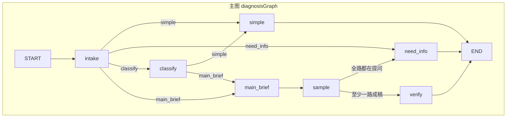
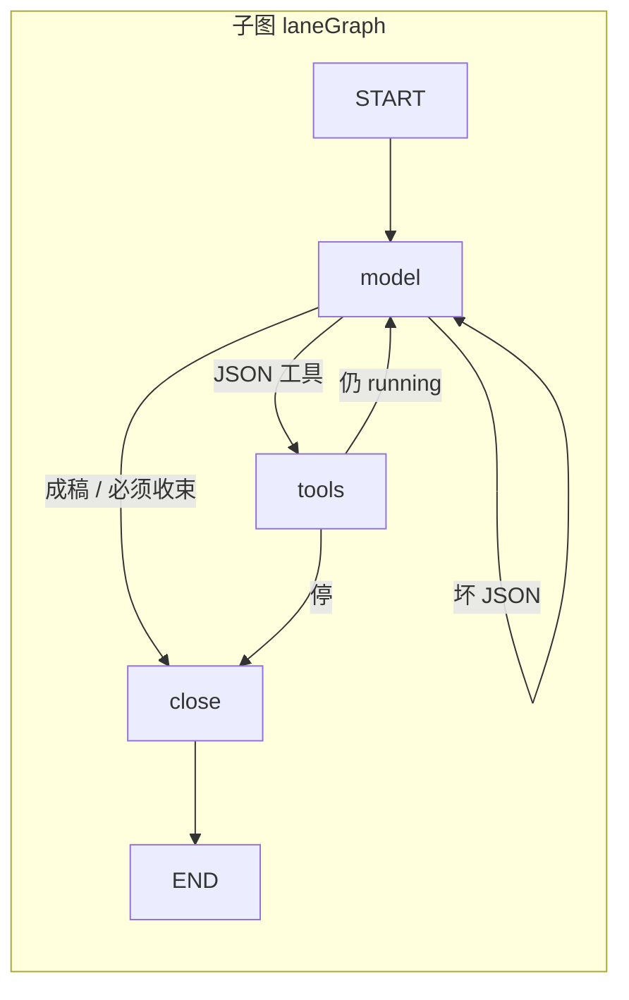

# SAMA 2.0 Agent 结构报告书

日期：2026-11-03  
代码目录：`sama2.0/`  
入口：`sama2.0/index.mjs` → `graph.mjs` 的 `runSama2`  
配套文档：[算法数学推导](./SAMA-算法数学推导.md) · [使用说明](./SAMA-使用说明.md) · [数据库说明书](./SAMA-数据库说明书.md)

本报告按**当前正在运行的代码**写，不按设想稿或旧 Electron 窗口写。页面上的 `/report` 仍渲染短版 `sama2.0/SAMA2-架构报告.md`；这份是完整结构说明。

---

## 0. 系统是什么

SAMA 2.0 是磨床故障诊断 Agent。它不是聊天机器人，也不是直接把模型输出当维修指令。一次请求走固定状态图：先决定这条题该问、该一次答，还是该开多路排查；多路排查时每一路自己思考、调工具、写成方案；程序核对出处、加权打分，最后把综合分**第一名和第二名**连同分项分交给用户自选。

三层责任划分：

| 层 | 谁做 | 不能做什么 |
| --- | --- | --- |
| 程序 | 门控、检索树、出处核对、加权、mechanism 否决、跳数停机 | 不编造数值、不指定维修结论 |
| 生成模型 | 每路思考、选工具、写方向卡和成稿 | 不能自己宣布中选、不能绕过观察写热变形清单 |
| 评判模型 | 五项分 + 三层参考分；准确性专评只审计第一名 | 不能重写方案、不能改名次 |

本地资料默认是 SQLite `reference` 模式：原文参考，**专业审核通过数为 0**。历史处理和手册数值不是本机阈值。

---

## 1. 运行时与模块地图

### 1.1 栈

- 语言：Node.js ≥ 22.13（使用 Node 自带 `node:sqlite`）
- 主图 / 子图：LangGraph `StateGraph`
- 模型：LangChain `ChatOpenAI`，对接 DeepSeek 兼容接口
- 工具：LangChain `tool()` + zod
- 页面：`server.mjs` 在 `127.0.0.1:3920` 提供静态页和 `POST /api/ask`

本机 Node 可用 `D:\SAMA\_node\node.exe`，不依赖系统全局 Node。

### 1.2 两张图

主图编译名 `diagnosisGraph`，递归上限 14。子图 `laneGraph` 递归上限约为 `maxStep + toolLimit + 8`。

### 1.3 源文件职责

| 文件 | 职责 |
| --- | --- |
| `index.mjs` | 导出 `runSama2`；命令行直接跑一题 |
| `graph.mjs` | 主图节点、路由、`verifyNode` 组装答复 |
| `stages.mjs` | 简单答复、追问答复、采样波、评判打包 |
| `reactLoop.mjs` | 单路 ReAct |
| `prompts.mjs` | 五路同一套系统提示 + 工具表 |
| `tools.mjs` | 工具登记与执行器 |
| `config.mjs` | 超参 |
| `complexity.mjs` / `gaps.mjs` / `facts.mjs` | 复杂度、四项门控、事实提取 |
| `retrieval-tree.mjs` / `embed.mjs` / `evidence.mjs` | 检索树、向量代理、证据选路 |
| `grounding.mjs` | 出处核对 |
| `judge.mjs` / `score.mjs` / `accuracyJudge.mjs` | 加权、名次、准确性审计 |
| `brief.mjs` | 主控分析简报（假设清单，不是结论） |
| `supervisor.mjs` | 路内独立监督 |
| `library.mjs` / `sama-sqlite/*` | 资料检索 |
| `guard.mjs` / `pool.mjs` | 步数预算、并发 |
| `llm.mjs` / `settings.mjs` | 模型调用与密钥 |
| `server.mjs` / `public/index.html` | HTTP 与页面 |
| `log.mjs` | 结构化事件 |

---

## 2. 一次请求的完整数据流

用户文字（加会话补充）进入 `runSama2({ userText, session, forceMultiAgent, maxStep, allowWeb, ... })`。

### 2.1 会话拼装

`composeSessionQuery`：若有 `session.origin`，把原题和历次补充用换行拼成 `query`。页面刷新即丢会话，不写库。句子出现「更正为」时，工况 / 热态只看最后一个标记之后的文本。

### 2.2 intake：事实 + 硬规则 + 门控

1. `extractFaultFacts`：机型、现象列表、空载/磨削、冷机/热机、约束、子系统模板。
2. `classifyByRules`：返回 `simple` / `complex` / `null`（边界，交给分类模型）。
3. `gateDecision`：软门控或硬门控，见第 3 节。

路由：

| 条件 | next |
| --- | --- |
| 非强制五路，且硬规则 simple 或门控 `answer` | `simple` |
| 门控 `ask`，或强制五路但仍缺项且该项追问未满 2 次 | `need_info` |
| 强制五路且可采样 | `main_brief`（复杂度记 `force`） |
| 硬规则 complex | `main_brief` |
| 其余 | `classify` |

### 2.3 四条出口

**simple**  
Main 检索后一次生成。核对扭矩 / 间隙 / 压力；对不上的数字加警告，文字仍交付。无本机案例 id 时加横幅「待验证主方向」。

**need_info**  
本轮不检索、不采样、不写维修步骤。正文只有固定问法。`session` 带回 `origin`、`askedCounts`。输入框改成「补充回答」。

**classify**  
四项齐了、硬规则说不准时才调分类器。判 simple → 一次答复；否则当 `boundary` 进采样。分类失败按复杂处理。无 API Key 直接报错。

**sample → verify**  
复杂题一次开满 5 路。边界题先开第 1 路；若成稿写「信息不足」、安全分低于 6、或出处 `G=0`，第二波补其余 4 路。整次最多两波。

只要**至少一路写成方案**就进 `verify`。追问附在文末「待确认问题」。只有谁都没写完才整轮停在补充。提问的那一路不进加权。

---

## 3. 门控与复杂度（程序，不是模型）

### 3.1 四项必填

| id | 识别 | 缺了问什么 |
| --- | --- | --- |
| machine | STUDER / 高桥 / MIKROSA / 鹰贝 / 外圆磨床等家族词。单独「磨床」不算 | 写出家族或型号 |
| phenomenon | 发热、振动、异响、超差、爬行、漏油、报警等 | 至少一个现象 |
| load | 空载 / 磨削。两者都出现且不是测量读数时算冲突 | 出现在空载还是磨削 |
| thermal | 冷机 / 热机 | 刚开机还是已运转 |

### 3.2 软门控（默认 `SAMA2_GATE=soft`）

- 知识问（「是什么 / 原理 / 怎么选」且不是「最可能的原因」）→ 直接 `answer`，不追问。
- 四项齐全 → `sample`。
- 缺工况或热态：按「磨削中」「热机」假设后仍采样，方案必须保留假设句。
- 机型 / 现象双缺且不是原因题：才硬追问。
- 同一字段最多问 2 次（`askedCounts`），之后不再挡采样。

硬门控 `SAMA2_GATE=hard`：缺项就问，不假设。

用户补充过一轮后，采样不再提供 `ask_user` 工具，避免反复追问进不了评分。

### 3.3 硬规则复杂度

复杂优先于简单：

1. 两类以上现象组（热 / 振 / 响 / 精度 / 运动 / 液压润滑 / 报警）
2. 偶发 / 间歇
3. 已换已查问题仍在
4. 要求结合型号与历史维修
5. 在问故障原因（`asksForCause`）

简单：概念、参数保养备件、短日常保养（≤36 字且无故障现象）。其余 `null` 交分类器。

---

## 4. 采样波：五路如何真正不同

五路**同一套提示、同一套工具**，没有预分的「根源专家 / 风险专家」。差别来自程序：

1. **分温入口查询** `buildLaneEntries`  
   温度默认 `(0.35, 0.5, 0.85, 1.0, 0.95)`。低温路落在原句；高温路 Softmax 抽桥接 / 机理槽。跨路 Jaccard 超过 0.5 则重抽。同一温度传给该路 ReAct 的 `tauProp`。
2. **检索树** `runSqliteTree` → `decorateTree`  
   在模型思考之前，按该路入口词建树、分级、必要时 FLARE。树文本作为第 0 步观察注入，`reason=retrieval_tree`。
3. **主控简报** `buildBrief`  
   五路树文本拼起来后，Main 产出假设与必查项（不是维修结论）。第 5 路额外要求挑战简报。
4. **种子** `seedBase + index`，默认从 1000 起。
5. **错开启动** 400 ms，并发最多 5，每路 180 s，单次模型 90 s。

`mapLimit` 用固定工人池保序执行。

---

## 5. 单路 ReAct（laneGraph）

状态只在这一路：`notes`、`trace`、`plan`、`direction`、`questions`。别的路看不见。

### 5.1 第 0 步观察

- 用户补充：`user-reply`
- 检索树：伪装成已执行的 `search_knowledge`，带 SQLite 标准头和【可用证据】

### 5.2 model 节点

模型只输出 JSON，二选一：调一个工具，或给出 `direction` + `final`。多段工具 JSON 只执行第一段。解析失败记 `bad_json`，回到思考，不进评分。

提议温度 = 该路 `tauProp`（分温）；被迫成稿温度 `0.2`。

### 5.3 停机（全部由程序判定）

| 条件 | 结果 |
| --- | --- |
| 同一工具同一参数再查 | 按已有观察写方案 |
| 新观察与上一条前 200 字相同 | 停查 |
| 已执行 4 次真实工具 | 下一步必须成稿 |
| 到达 `maxStep`（默认 8，硬顶 50） | 禁止工具，整理方案 |
| 整次步数名额用完（5×maxStep） | 不再开新步 |
| 剩余时间不足 8 秒 | 整理已有观察 |
| 单次工具超过 5 秒 | 记超时再整理 |
| `ask_user` 参数合格 | 本路 `need_info`，不写方案 |
| `ask_user` 参数不合格 | 记观察，继续思考 |

### 5.4 close 节点

- 方向卡 `sanitizeDirection`：无证据的通识机理（热变形、砂轮、冷却等）从主方向删掉
- 独立监督者最多两次只读检索，新资料**不写回**本路证据
- 程序出处与缺项优先于监督者判断
- 「最安全 / 最优 / 建议采用本方案」从送给监督者的副本删除
- 隔离 / 断电 / 砂轮防护只记录，不淘汰方案
- 监督者发现仍缺必填项且本轮不允许假设：本路改 `need_info`

---

## 6. 工具表

五路工具表相同。`domain` 液压 / 润滑 / 主轴 / 进给 / 冷却都按机械检索；只有电路 / 电气 / PLC / LAD 明确拒绝。

| 工具 | 作用 | 程序约束 |
| --- | --- | --- |
| `search_knowledge` | 本地资料 | SQLite 启用时走全量库；返回 `sqlite_*` id |
| `lookup_baseline` | 测点模板 | 对不上子系统不默认主轴；发热仍映射主轴 |
| `lookup_grind_dialect` | 家族识别 | 只给家族，不给扭矩间隙 |
| `ask_user` | 硬分叉提问 | 一路最多 2 问；id `[a-z0-9_]{1,32}`；问句 ≤80 字 |
| `record_measurement` | 记下原文读数 | 只接受扭矩 / 间隙 / 压力，且必须出现在用户原文 |
| `search_mtkb` | 本机案例 | SQLite 启用时不再打 8765；品牌型号由程序填 |
| `web_search` | 网页 | 默认不在表里。勾选或 `SAMA2_ALLOW_WEB=1` 才加入。无 URL 的条目丢掉 |

本地库未命中且允许联网时，可自动附带网页结果，必须标明「来自网络、需核对本机」。

观察预算约 3500 字符；SQLite 工具文本预算约 3400。超长时**整条跳过**并列出未传入 id，不截断条件或出处。

---

## 7. 树之后的证据选路

检索树解决「把近邻放进观察」。模型仍可能用参数记忆里的冷却 / 砂轮 / 热变形当主因。`evidence.mjs` 接在树后：

1. **分级** SUPPORT / NEAR / IRRELEVANT，SUPPORT 置顶（Lost in the Middle）
2. **方向卡** 主方向必须来自 SUPPORT 或 NEAR
3. **无 SUPPORT 时 FLARE 一次补检**，是否采纳仍走 $\Delta G>0$
4. **过程分** 0 / 1 / 2
5. **ALCE 封顶** 成稿主因无 `obsId` / `sqlite_*` 则准确性 $\le 5$

无 SUPPORT 时横幅改为只用近邻选待验证主方向，禁止展开通用磨床清单。

公式见[算法数学推导](./SAMA-算法数学推导.md) 第 6～8 节。

---

## 8. 交付：出处 → 评判 → 前两名

### 8.1 出处

`checkGrounding`：方案里的扭矩 / 间隙 / 压力必须能在观察（含用户原文）里按规范化字符串找到。`0.02` ≠ `0.020`。笔记 id、`sqlite_*`、`FR-`、URL 必须是观察里出现过的完整 id，前缀相同不算。

没通过的方案离开候选。五路都不通过：只说明没有可交付方案，列出无出处数值，不展示那些正文。

### 8.2 评判

温度 0.1。模型打五项分，程序算加权。`accuracy` 语义是**方向契合**，不是「看起来像完整维修单」。`mechanism < 5` 硬否决；全组都低于阈值时按总分保底，note 写明。

### 8.3 用户看到什么

- 第一名（推荐）全文 + 分项 + 加权 + 分层
- 第二名全文 + 同样的评分
- 评分对照表
- 准确性审计只针对第一名，不改名次

作者开关打开后还能看到五路思考、流程、停因。

API 打包字段：`judge.winnerId`、`judge.runnerUpId`、`judge.ranked`。

---

## 9. 主图状态（DiagnosisState）

`options, started, config, query, sessionQuery, facts, hard, complexity, brief, plans, asked, assumptions, gatePending, need, next, result`

子路上下文放在 `reactLoop` 的 `contexts` Map，不进主图，避免把工具闭包序列化进 LangGraph checkpoint。

---

## 10. 模型角色一览

| purpose | 何时 | 温度 | 模型名 |
| --- | --- | --- | --- |
| generate | 简单答复、各路思考 / 成稿 | 路温或 0.2 | `SAMA2_MODEL` |
| judge | 分类器、简报、评判、安全抽查、监督、准确性专评 | 0.1 | `SAMA2_JUDGE_MODEL`，空则同生成 |

429 时等待 2 秒再试一次。无 Key 抛 `NO_API_KEY`。

---

## 11. 明确不是什么

- 不是「模型自己选冠军」
- 不是硬编码两跳检索；跳数由 $\Delta G$ 决定
- 不是把留出集金标写回提示词
- 不是把数据库历史处理当本机指令
- 不是 Electron 旧界面；当前只有浏览器页和 CLI

---

## 12. 建议阅读顺序

1. 本报告第 2、4、5、8 节（请求怎么走）
2. [算法数学推导](./SAMA-算法数学推导.md)（检索树、BM25、评分）
3. [数据库说明书](./SAMA-数据库说明书.md)（能查到什么、为什么查不到）
4. [使用说明](./SAMA-使用说明.md)（怎么开、怎么问、怎么读结果）
