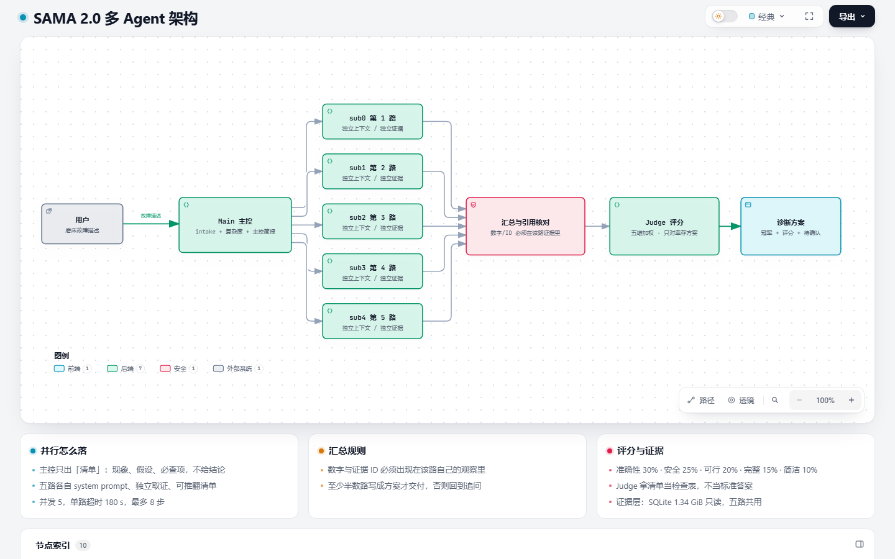
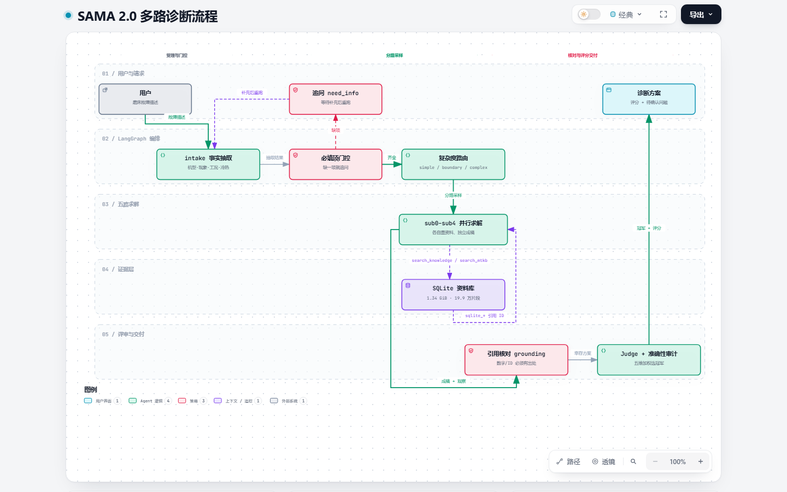

# SAMA 2.0 架构评审报告

- 评审日期：2026-10-28
- 被评版本：`D:\SAMA\SAMA` 工作区（HEAD `27f82eb`，另有 14 个未提交改动，含本轮多数交付、独立 judge 模型等）
- 运行环境：Node v22.20.0（`D:\SAMA\_node`）、`node:sqlite` 实验特性、模型 `deepseek-chat`
- 配套图：[sama-agents.html](./sama-agents.html) 多 Agent 架构 + [sama-flow.html](./sama-flow.html) 诊断流程（均通过 Archify 四道门禁；源文件 `*.candidate.json`）

---

## 一、总体结论

**骨架是清楚的：一张 LangGraph 主图做编排，每路是一个独立的 ReAct 子图，外面套四道确定性关卡（门控、引用核对、评分、准确性审计）。**

主要问题不在「结构乱」，而在**决策点太硬**：门控缺一项就整轮追问、边界题只采一路且那一路一问就停、案例查询依赖子 agent 自己写的查询词。结果是 8 道真实题只交付 3 道。

| 维度 | 结论 |
|---|---|
| 模块划分 | 清楚：编排 / 单路求解 / 证据 / 评分 / 配置 五层，依赖方向单一 |
| 状态机 | 明确：6 个节点、3 条条件边，无环（除子图内部 ReAct） |
| 多 agent 机制 | 真并行：5 路独立 system prompt + 独立工具 + 共享步数预算，`mapLimit` 并发 5 |
| 确定性关卡 | 齐全：字段门控、重复调用拦截、观察前缀收束、引用核对、评分失败保底 |
| 交付率 | 偏低：8 题交付 3 题（12 题自然提问口径下历史最低 0） |
| 可观测性 | 好：JSONL 事件日志，含 route/step/judge/accuracy/model |

---

## 二、模块地图

| 层 | 文件 | 职责 |
|---|---|---|
| 入口 | `index.mjs` / `server.mjs` | CLI 与 HTTP（`POST /api/ask`，可传 apiKey/baseUrl/model/judgeModel） |
| 编排 | `graph.mjs` | LangGraph 主图：intake → simple/need_info/classify/main_brief/sample → verify |
| 主控简报 | `brief.mjs` | 只产出假设与验证清单，不产出结论；失败时静默降级 |
| 单路求解 | `reactLoop.mjs` | 每路一个子图：model → tools → close，含步数预算与收束 |
| 提示 | `prompts.mjs` | 五路角色、工具说明、收束指令 |
| 门控 | `gaps.mjs` / `complexity.mjs` / `mainAgent.mjs` | 四要素抽取、硬规则分流、简单题直答 |
| 并发 | `pool.mjs` | `mapLimit`，并发上限 5 |
| 证据 | `tools.mjs` / `library.mjs` / `sama-sqlite/*` | 工具注册、SQLite 检索、旧 Markdown 回落 |
| 监督 | `supervisor.mjs` | 每路中途独立复核（最多 3 轮、2 次只读工具） |
| 核对 | `grounding.mjs` | 数字/ID/URL 必须出现在证据（含用户原文）里 |
| 评分 | `judge.mjs` / `score.mjs` / `accuracyJudge.mjs` | 五维加权选冠军、准确性审计、失败保底 |
| 配置 | `config.mjs` / `settings.mjs` | 运行参数、模型与 key 读取 |
| 其他 | `baselines.mjs` / `dialect.mjs` / `measurements.mjs` / `webSearch.mjs` / `log.mjs` | 测点模板、机床家族、读数登记、联网、日志 |

依赖方向：`graph → stages/reactLoop → tools/library → sama-sqlite`，反向没有引用；`settings` 是唯一配置出口。

---

## 三、运行时主图

`graph.mjs` 的 6 个节点：

| 节点 | 作用 | 出口 |
|---|---|---|
| `intake` | 解析事实、四要素检查、复杂度硬规则 | `simple` / `need_info` / `classify` / `main_brief` |
| `main_brief` | 主控分析简报：现象、假设、必查项、禁止项（可关） | `sample` |
| `simple` | 调 `answerSimple`：查库 + 模板，一次成稿 | END |
| `need_info` | 输出 1–4 个必填问题 | END |
| `classify` | 边界题交给分类模型 | `simple` / `sample` |
| `sample` | 分路采样 + 二段补采 + 多数交付判断 | `need_info` / `verify` |
| `verify` | 引用核对 → Judge → 准确性审计 | END |

边：`intake` 条件四选一；`classify` 二选一；`sample` 二选一；其余直连 END。主图 `recursionLimit=12`，没有环。

单路子图（`reactLoop.mjs`）是真正的循环：`model → tools → model`，直到写成方案、触发收束（重复调用/观察前缀相同/步数用尽）、或超时；`recursionLimit = maxStep + toolLimit + 8`。

---

## 四、多 agent 怎么协作

1. **同一份输入，五种独立解读**：`buildRoles(5)` 给每路独立 system prompt（「第 N 路独立求解，只对自己的判断负责」），不共享中间推理，只共享工具与步数预算。
2. **真并行**：`mapLimit(roles, 5, runReactSub)` 同时起 5 路，`staggerMs=400` 错峰；单路超时 180 s，整轮 LLM 超时 90 s。
3. **每路自己查证据**：`search_knowledge` / `search_mtkb`（SQLite）、`lookup_baseline`、`lookup_grind_dialect`、`ask_user`、`record_measurement`；步数上限 `maxStep=8`（可调到 50）。
4. **中途独立监督**：`superviseMid` 只对照清单（数值是否有出处、四要素是否缺失、是否写了隔离断电），可以自己再查两次资料，但不改写方案、不选冠军。
5. **二段采样**：边界题先采 1 路，若出现「信息不足」、安全性 < 6、或引用命中为 0，再补 `sampleCount-1` 路，最多 2 轮（`waveCap`）。
6. **汇总**：完成的方案先过引用核对，幸存者交给 Judge 五维加权排序；冠军再做一次准确性审计。

并发与预算：5 路 × 最多 8 步，单请求理论上限约 40 次工具调用 + 40 次模型调用；没有跨请求的排队或限流。

---

## 五、门控与交付（本轮改动最多的地方）

- **入口门控**：四要素（机床家族/型号、现象、空载或磨削、冷机或热机）缺一项就追问；这是 12 道自然提问里 0 交付的主因，本轮已补现象词典、修工况误判，但门控本身仍保留。
- **多数交付**（新）：采样后若「有路提问」且「完成路数 < 半数」，才整轮转追问；否则继续交付，并把未决问题以 `### 待确认问题` 附在答案末尾（`graph.mjs:140-160`）。
- **边界题的硬门槛**：边界题只采 1 路，`majority = ceil(1/2) = 1`，所以那一路一旦提问，完成数为 0 < 1，直接回到追问。这是当前交付率的主要瓶颈。
- **简单题不受门控**：`simple` 分支直接查库作答，参数类问题会明确拒绝编造数值（实测油压题表现正确）。

---

## 六、证据与评分

- **引用核对**：数字（MPa/mm/μm/N·m 等）、`knowledge/...#起-止`、`sqlite_curated|fragment|case:数字`、`FR-xxx`、URL 都必须在证据里出现。本轮把「用户原文」并入证据集，解决了「用户给的读数复述被误杀」的问题；代价是用户自己写错的数字也会被当成有出处。
- **Judge**：五维加权（准确性 30%、安全 25%、可行 20%、完整 15%、简洁 10%），温度 `tauJudge=0.1`；只在幸存方案里选，冠军按总分 → 安全 → 准确性 → id 兜底。
- **独立性**：`SAMA2_JUDGE_MODEL` / `judgeModel` 可把评判与生成拆成两个模型；默认仍回落到生成模型（未强制拆开）。
- **失败保底**：Judge 调用失败不再伪造 0 分排名，而是按完整度保底选一份并标注「评分不可用…（未评分）」；准确性审计失败会写「审计未完成」，不改变中选结果。
- **量纲**：准确性/可信度强制 0–10；模型若按 0–1 给分会被 ×10 并记 `accuracy_scale_normalized` 日志。

---

## 七、失败与降级路径

| 场景 | 行为 |
|---|---|
| 无 API Key | `NO_API_KEY`，主图抛错，HTTP 返回 `ok:false` |
| 某一路模型 500 | 该路 `failed`，其余继续；失败路不参与中选 |
| 工具超时 | 该路收束为「工具超时」，不拖垮其他路 |
| 重复调用/相同观察前缀 | guard 拦截并收束，防死循环 |
| 步数用尽 | 强制进入收束提示，要求直接成稿 |
| 分类模型失败 | 按 complex 处理（宁可多查） |
| Judge 失败 | 保底选一份，标注未评分 |
| SQLite 打开失败 | 返回「SQLite检索失败…不得声称已命中」，不静默回落旧库 |

所有分支都有 `logEvent`，可按 `route/step/tool/judge/accuracy/finish` 检索。

---

## 八、测试覆盖

当前全绿：数据库测试 15 项 + 核心 4 套（rules/gates/guard-run/flow）。

覆盖到的：包还原与校验、引用协议、模式与领域边界、工具真实 invoke、五路并行收到 SQLite 观察、门控与收束、重复调用拦截、超时、多数交付、评判走独立模型名。

没覆盖到的：多轮补充会话（session supplements）的完整回归、并发多请求、长上下文截断、真实工单答案质量、Judge 与人工评分的一致性。

---

## 九、结构风险

| 级别 | 风险 | 位置 | 影响 |
|---|---|---|---|
| P0 | 边界题只采 1 路，一问就停 | `graph.mjs:140-160` + `majority` 计算 | 5/8 的真实题卡在这里 |
| P0 | 案例查询用子 agent 改写后的 query | `sama-sqlite/library.mjs:30-39` | 丢章节号 → 误报「多章节重号」→ 追问 |
| P1 | 证据集并入用户原文后，核对强度下降 | `stages.mjs:136` | 用户写错的数值会被当成有出处 |
| P1 | 无跨请求限流/排队 | `server.mjs` | 多请求并发时 5 路 × 多次调用容易触发 429 |
| P1 | Judge 默认同模型 | `settings.mjs` | 自评偏差仍在，需要显式配 `SAMA2_JUDGE_MODEL` |
| P2 | 主图 `recursionLimit=12` 写死 | `graph.mjs:230` | 复杂分支可能提前触顶 |
| P2 | 日志无轮转 | `logs/sama2.log` | 长期运行会持续增长 |
| P2 | 单路 40 次调用上限没有整体预算 | `config.mjs` | 极端题目成本不可控 |

---

## 十、建议

1. **先放边界题的交付**：边界题采完 1 路后，若该路只是提问、但已有可用成稿，允许交付并附问题；或直接把边界题升到 3 路，用多数规则判断。
2. **案例查询保留原始问句**：`search_mtkb` 同时传 `facts` 和用户原句，章节号从原文取，不从子 agent 的改写取。
3. **证据分层**：把「用户原文」「工具观察」「人工核对」分开标注，核对时区分强度，而不是简单拼接。
4. **默认拆开评判模型**：至少文档里写清「不配就是自评」，并在结果里回传 `judgeModel`。
5. **加跨请求并发闸**：全局信号量或队列，避免 5 路 × N 请求同时打满。
6. **补多轮会话回归**：`session` 补充路径目前没有端到端测试。

---

## 十一、无本地资料时，引用核对在核对什么

先澄清一个容易误解的点：`grounding` **不判断答案在医学/工程上对不对，也不查数据库里有没有这条知识**。它只做一件事：

> 方案里出现的每一个数字（MPa/mm/μm/N·m/°C…）、每一个证据 ID（`sqlite_*`、`FR-*`、`knowledge/...#起-止`）、每一个 URL，是否真的出现在**这一路自己拿到的证据**里。

证据 = 该路的工具观察 + 用户原文（本轮把用户原文并进来了）。

所以「问一个库里完全没有的问题」会发生三件事：

1. **工具观察为空** → 方案里只要写了具体数值，全部判「无出处」，整份方案被 rejected；
2. **方案不写数值** → 通过核对，但引用数是 0，Judge 只能按结构、安全性、可行性打分，准确性维度没有依据；
3. **系统不会主动说「本地没有资料」**。检索工具会返回一句「没有符合范围的资料」，但这句话只是观察之一，模型可能据此写通用方案，用户看到的仍是一份正常答案。

这就是当前核对机制的边界：**它防的是编造，不是无知**。建议补一条：当所有路的证据里都没有 `sqlite_*` 命中时，在答案头部明确标注「本地资料无依据，以下为通用排查」，并把 Judge 的准确性权重降下来，避免给通用答案打出高分。

另外，用户原文并入证据后，用户自己写错的数值也会被当成「有出处」——这是为了修「复述用户读数被误杀」，但代价是「用户数据」和「资料证据」不再区分。更稳的做法是给证据打来源标签，核对时分别计权。

## 十二、主 sub 分析简报方案评估（已实现）

你提的「先由一个主 sub 分析问题，再把分析交给后面的分 agent」——方向合理，但要看它产出什么。

**合理的部分**

- 统一问题拆解：五路不会各自跑偏到不同故障假设；
- 省 token：不用每路重新理解一遍故障；
- 给 Judge 一份稳定的评分口径（要看哪些现象、哪些约束），打分更一致；
- 和现有代码衔接自然：`intake` 已经产出 `facts`，`buildRubric(caseNotes)` 已经把「必须覆盖的现象/设备/现场约束」传给 Judge，只差一层结构化。

**风险**

- **多样性塌缩**：五路如果都照着同一份分析写，Best-of-N 就退化成「同一答案的五个改写版」，打分再准也没意义；
- **单点错误放大**：主分析把根因猜错，五路一起错，而且互相印证，看起来更可信；
- **Judge 被锚定**：把「问题分析」当评分参考，容易奖励「符合分析」而不是「证据支持」，这和引用核对的初衷冲突。

**我的建议（折中版）**

1. 主 sub 只产出「清单」，不产出「结论」：现象列表、必须排除的假设、必查测点、验收标准、现场约束；
2. 五路仍各自取证、独立成稿，且允许推翻清单里的假设（成稿里要写「与清单不一致之处」）；
3. Judge 拿到的是「清单 → 是否逐项回应」的检查表，不是「标准答案」；准确性维度仍以引用核对为准；
4. 保留一路「反方」：专门挑战主分析，防止五路同质化；
5. 在结果里回传 `brief` 与各路对 brief 的偏离度，便于事后评估这套机制到底有没有提升。

一句话：**主 sub 适合当「出题人 + 验收清单」，不适合当「标准答案」**。给 Judge 传分析可以，但要传成「评分维度」，不能传成「正确答案」。

### 实现落地（2026-10-28）

- `sama2.0/brief.mjs`：`buildBrief` 产出 `phenomena / hypotheses / mustCheck / exclusions / acceptance / confidence`，解析失败返回 `ok:false` 并静默降级；
- `graph.mjs` 新增 `main_brief` 节点，`SAMA2_BRIEF=0` 可关，`recursionLimit` 12→14；
- `sampleWave` 把简报追加进每路 system，第 5 路（`sub4`）加「反方」指令；
- `rubric.mjs` 把必查项/禁止项/验收并入 Judge 的 `caseNotes`，并生成 `checklist`；
- `reactLoop.mjs` 收束时读取 `brief_deviation`，结果里回传 `briefDeviation`；
- 新增 `test-brief.mjs` 12 条断言全过；回归 15 项 DB + 4 套核心仍全绿。

实测一题（外圆磨床热机振纹）：4 条假设、5 条必查项；第 5 路写出明确反方意见（「h1 把砂轮修整当线索，实际应优先热态间隙」），Judge 分 7.55/7.0/7.0/6.6，accuracy 8。

## 附：图

### 多 Agent 架构（主控 → 五路并行 → 汇总 → 评分）



交互版：[sama-agents.html](./sama-agents.html)；源文件 `sama-agents.candidate.json`。五个 sub 节点是真实并行的独立求解进程，扇出与汇入都画在图上；Main 已标注「intake + 复杂度 + 主控简报」，brief 节点未单独画出以免连线拥挤，细节见第十二节。

### 诊断流程图（含门控与追问回环）



交互版：[sama-flow.html](./sama-flow.html)

图中五条泳道：用户与请求、LangGraph 编排、五路求解、证据层、评审与交付。

- 主干：`用户 → intake → 门控 → 路由 → 五路 → 引用核对 → Judge → 交付`；
- 异常：门控缺项进「追问」，补充后回到 intake；
- 证据：五路通过 `search_knowledge / search_mtkb` 只读访问 SQLite，拿回 `sqlite_*` 引用 ID；
- 卡片记录三条现状：门控与多数交付规则、资料层 33.5% 可检索/6.1% 磨床、五维评分权重与可拆分的评判模型。

## 复现

```powershell
cd D:\SAMA\SAMA\sama2.0
D:\SAMA\_node\node.exe --test tests/database.test.mjs tests/database-flow.test.mjs
D:\SAMA\_node\node.exe test-rules.mjs; D:\SAMA\_node\node.exe test-gates.mjs
D:\SAMA\_node\node.exe test-guard-run.mjs; D:\SAMA\_node\node.exe test-flow.mjs
# 端到端 8 题（需要 API Key）
D:\SAMA\_node\node.exe D:\SAMA\audit\audit-after.mjs
```


