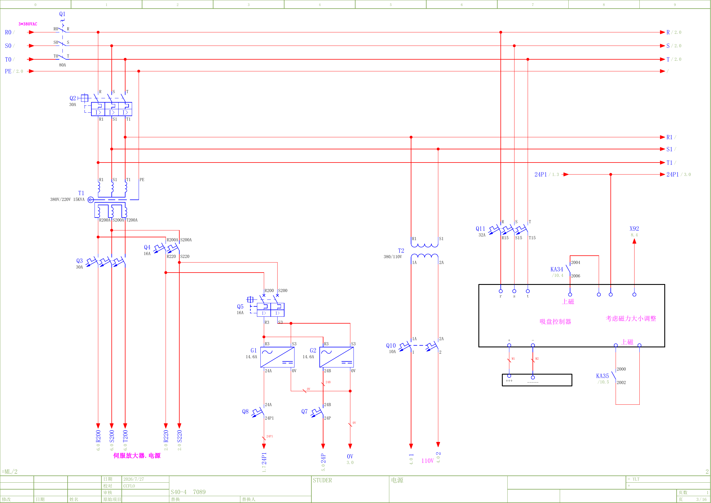

# FAVRETTO MC160：总电源、控制变压器、DC24V 与磁盘电源

> 资料一致性警告：PDF 封面写有“FAVRETTO MC160 / FANUC 0iTF”，但图框页脚同时出现“STUDER / S40-4 / 7089”。因此本案例只能作为待核对图纸，不能在未比对现场线号和元件铭牌前直接施工。

## 1. 功能

分配 3×380 VAC 总电源，建立 220 VAC、110 VAC、24 VDC 控制电源，并给磁盘控制器和伺服放大器供电。

## 2. 具体电路图

### 原图第 3 页



- [打开完整 16 页原始 PDF](../assets/favretto_mc160/FAVRETTO_MC160_电路图_原始文件.pdf)

## 3. 文字化电路图

```text
3×380 VAC(R0/S0/T0) → Q1 总开关 → Q2/T1 380/220 V 15 kVA；支路经 Q11、Q4/T2 380/110 V、Q3/Q5/Q10 → 控制电源、吸盘控制器、24 VDC 电源和伺服电源。
```

3×380 VAC(R0/S0/T0) → Q1 总开关 → Q2/T1 380/220 V 15 kVA；支路经 Q11、Q4/T2 380/110 V、Q3/Q5/Q10 → 控制电源、吸盘控制器、24 VDC 电源和伺服电源。

## 4. 故障诊断与核对点

- 核对 Q1 80 A、Q2 30 A、Q11 32 A 等标注是否与现场器件一致。
- 核对 T1/T2 容量、接地、二次侧保护和零伏基准。
- 磁盘控制器支路涉及退磁和工件保持，必须验证失电安全状态。

## 5. 修改或改造边界

- 元件编号和定值先与现场器件、线号、端子号逐项核对。
- 驱动器、制动电阻、编码器、抱闸和安全输入必须使用对应型号厂家手册。
- 不得仅依据本图确定线径、短路保护、接触器等级或 RC/电阻电容最终参数。
- 上电前执行断电验电、绝缘/接地检查、点对点校线和安全功能测试。

## 6. 来源与验证状态

- 本地来源：`参考资料/FAVRETTOMC160电路图NEW VER.pdf`
- 原图页：3
- 验证状态：图纸封面标识 FAVRETTO MC160；页脚项目字段出现 STUDER/S40-4 7089，归属与器件定值待现场核对
- 整理日期：2026-08-18
