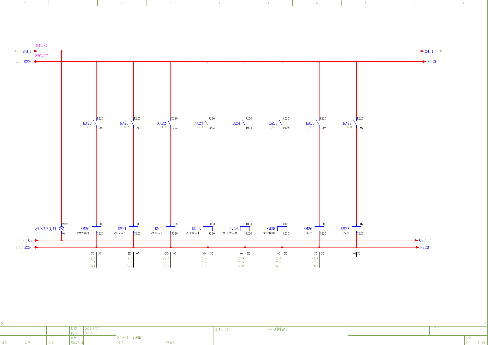

# FAVRETTO MC160：PLC 输出、KA20-KA27 与电机接触器控制

> 资料一致性警告：PDF 封面写有“FAVRETTO MC160 / FANUC 0iTF”，但图框页脚同时出现“STUDER / S40-4 / 7089”。因此本案例只能作为待核对图纸，不能在未比对现场线号和元件铭牌前直接施工。

## 1. 功能

用 24 VDC PLC 输出驱动中间继电器 KA20-KA27，再切换 220 VAC 接触器 KM20-KM27。

## 2. 具体电路图

### 原图第 5 页



- [打开完整 16 页原始 PDF](../assets/favretto_mc160/FAVRETTO_MC160_电路图_原始文件.pdf)

## 3. 文字化电路图

```text
PLC Y2.x/控制信号 → KA20…KA27 24 VDC 线圈 → KA 辅助触点 → KM20…KM27 220 VAC 线圈 → 电机主回路；接触器辅助触点用于状态确认。
```

PLC Y2.x/控制信号 → KA20…KA27 24 VDC 线圈 → KA 辅助触点 → KM20…KM27 220 VAC 线圈 → 电机主回路；接触器辅助触点用于状态确认。

## 4. 故障诊断与核对点

- 核对 PLC 输出类型与继电器线圈电压、续流/浪涌抑制。
- 检查 KA 与 KM 编号的一一对应和反馈触点。
- 不得直接用 PLC 小信号输出驱动不匹配的交流接触器线圈。

## 5. 修改或改造边界

- 元件编号和定值先与现场器件、线号、端子号逐项核对。
- 驱动器、制动电阻、编码器、抱闸和安全输入必须使用对应型号厂家手册。
- 不得仅依据本图确定线径、短路保护、接触器等级或 RC/电阻电容最终参数。
- 上电前执行断电验电、绝缘/接地检查、点对点校线和安全功能测试。

## 6. 来源与验证状态

- 本地来源：`参考资料/FAVRETTOMC160电路图NEW VER.pdf`
- 原图页：5
- 验证状态：图纸封面标识 FAVRETTO MC160；页脚项目字段出现 STUDER/S40-4 7089，归属与器件定值待现场核对
- 整理日期：2026-08-18
