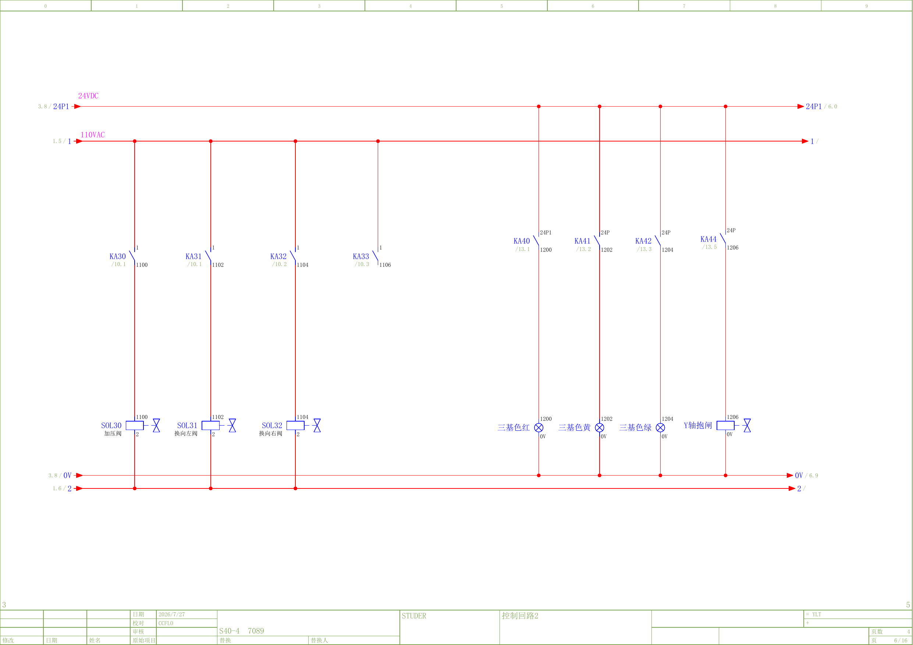

# FAVRETTO MC160：电磁阀、三色灯与 Y 轴抱闸控制

> 资料一致性警告：PDF 封面写有“FAVRETTO MC160 / FANUC 0iTF”，但图框页脚同时出现“STUDER / S40-4 / 7089”。因此本案例只能作为待核对图纸，不能在未比对现场线号和元件铭牌前直接施工。

## 1. 功能

控制加压阀、工作台左右换向阀、红黄绿三色灯和 Y 轴抱闸。

## 2. 具体电路图

### 原图第 6 页



- [打开完整 16 页原始 PDF](../assets/favretto_mc160/FAVRETTO_MC160_电路图_原始文件.pdf)

## 3. 文字化电路图

```text
PLC Y3.x/Y4.x → KA30-KA33/KA40-KA44 → SOL30/SOL31/SOL32、三色灯、Y 轴抱闸线圈 → 执行器动作。
```

PLC Y3.x/Y4.x → KA30-KA33/KA40-KA44 → SOL30/SOL31/SOL32、三色灯、Y 轴抱闸线圈 → 执行器动作。

## 4. 故障诊断与核对点

- 左右换向阀必须设置互斥和中位安全策略。
- Y 轴抱闸释放必须晚于伺服建立转矩，抱闸投入必须早于转矩撤销。
- 线圈端增加的 RC/二极管抑制器必须按 AC/DC、线圈功率和释放时间选型。

## 5. 修改或改造边界

- 元件编号和定值先与现场器件、线号、端子号逐项核对。
- 驱动器、制动电阻、编码器、抱闸和安全输入必须使用对应型号厂家手册。
- 不得仅依据本图确定线径、短路保护、接触器等级或 RC/电阻电容最终参数。
- 上电前执行断电验电、绝缘/接地检查、点对点校线和安全功能测试。

## 6. 来源与验证状态

- 本地来源：`参考资料/FAVRETTOMC160电路图NEW VER.pdf`
- 原图页：6
- 验证状态：图纸封面标识 FAVRETTO MC160；页脚项目字段出现 STUDER/S40-4 7089，归属与器件定值待现场核对
- 整理日期：2026-08-18
