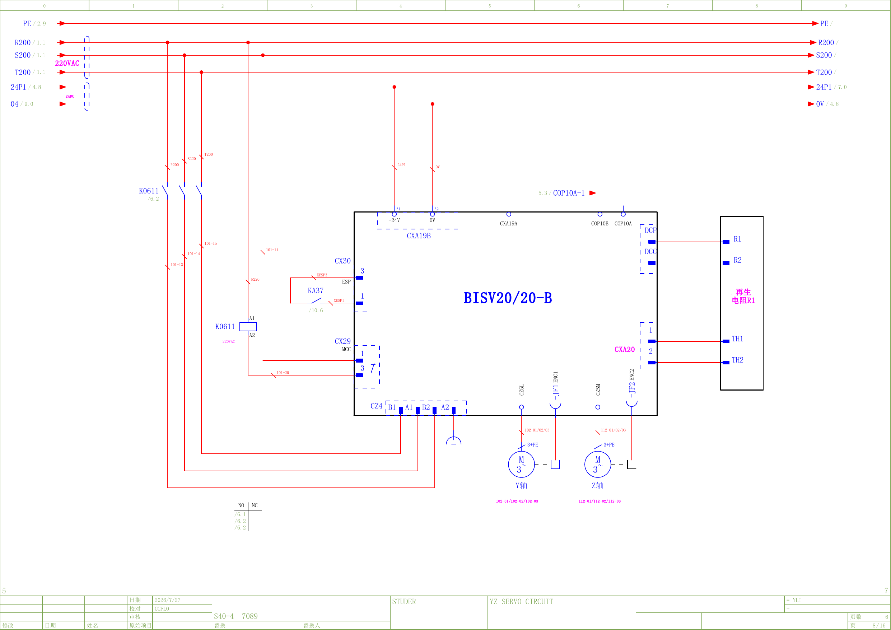

# FAVRETTO MC160：Y/Z 伺服、再生电阻、使能和抱闸接口

> 资料一致性警告：PDF 封面写有“FAVRETTO MC160 / FANUC 0iTF”，但图框页脚同时出现“STUDER / S40-4 / 7089”。因此本案例只能作为待核对图纸，不能在未比对现场线号和元件铭牌前直接施工。

## 1. 功能

为 BISV20/20-B 伺服放大器供电，连接 Y/Z 轴电机、再生电阻、急停/使能输入和抱闸相关接口。

## 2. 具体电路图

### 原图第 8 页



- [打开完整 16 页原始 PDF](../assets/favretto_mc160/FAVRETTO_MC160_电路图_原始文件.pdf)

## 3. 文字化电路图

```text
R200/S200/T200+220 VAC+24 VDC → BISV20/20-B；CXA19/CXA20/CX29/CX30/CZ4/COP 接口 → Y/Z 伺服电机、再生电阻 R1、ESP/使能、反馈与抱闸。
```

R200/S200/T200+220 VAC+24 VDC → BISV20/20-B；CXA19/CXA20/CX29/CX30/CZ4/COP 接口 → Y/Z 伺服电机、再生电阻 R1、ESP/使能、反馈与抱闸。

## 4. 故障诊断与核对点

- 再生电阻阻值、功率、热保护和安装间距必须按驱动器手册与负载惯量计算。
- ESP/急停与伺服使能必须核对硬件安全链，不能只由普通 PLC 输出实现。
- Y 轴抱闸时序需结合驱动器 ready、转矩建立和垂直轴防坠验证。

## 5. 修改或改造边界

- 元件编号和定值先与现场器件、线号、端子号逐项核对。
- 驱动器、制动电阻、编码器、抱闸和安全输入必须使用对应型号厂家手册。
- 不得仅依据本图确定线径、短路保护、接触器等级或 RC/电阻电容最终参数。
- 上电前执行断电验电、绝缘/接地检查、点对点校线和安全功能测试。

## 6. 来源与验证状态

- 本地来源：`参考资料/FAVRETTOMC160电路图NEW VER.pdf`
- 原图页：8
- 验证状态：图纸封面标识 FAVRETTO MC160；页脚项目字段出现 STUDER/S40-4 7089，归属与器件定值待现场核对
- 整理日期：2026-08-18
