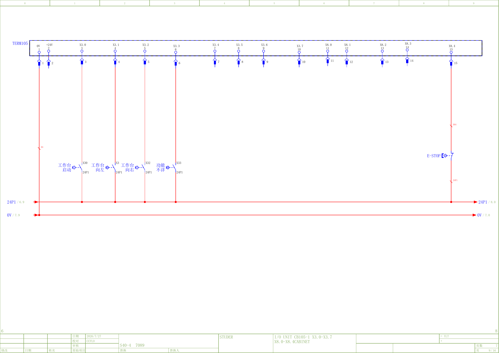
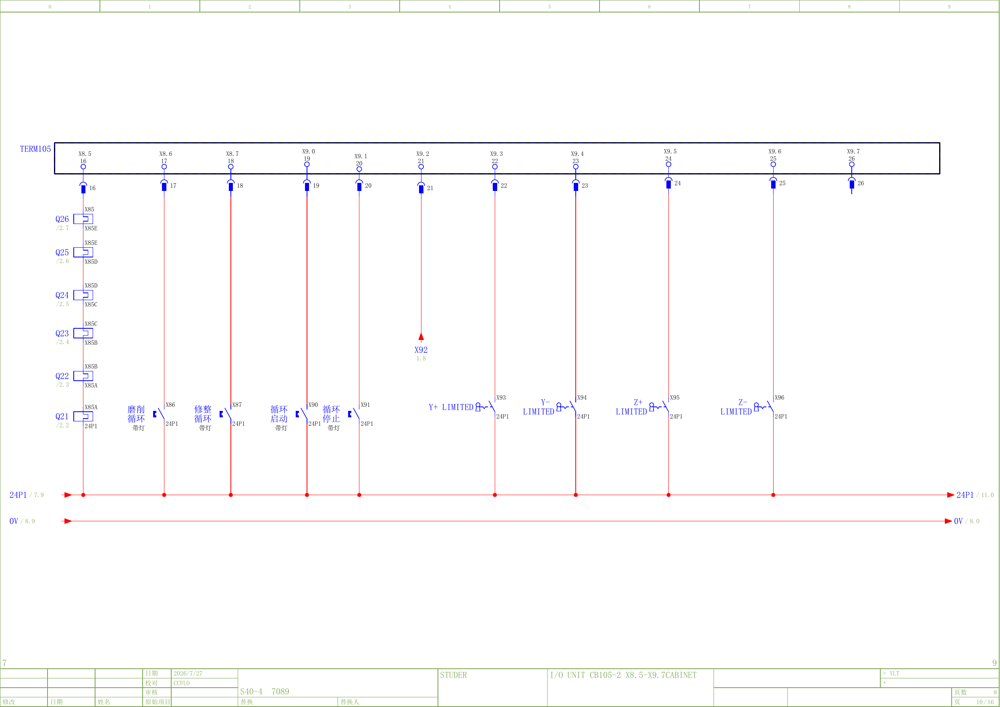
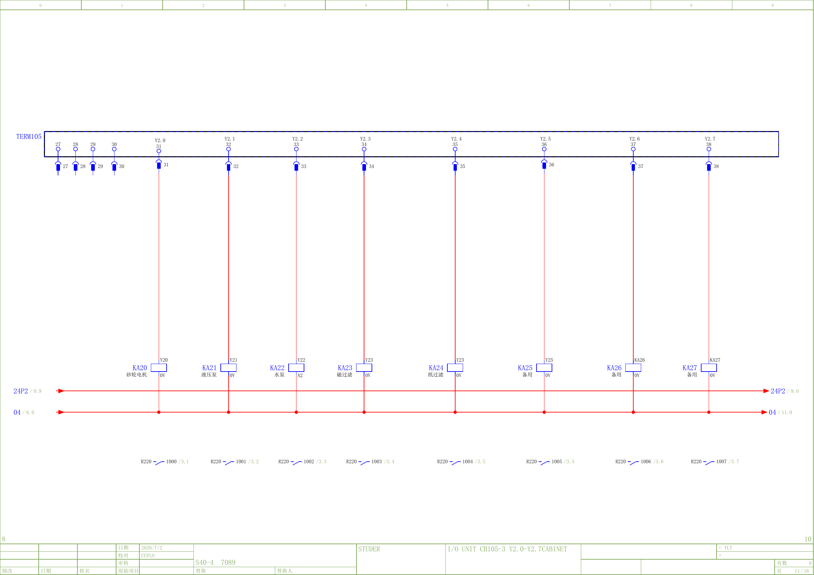
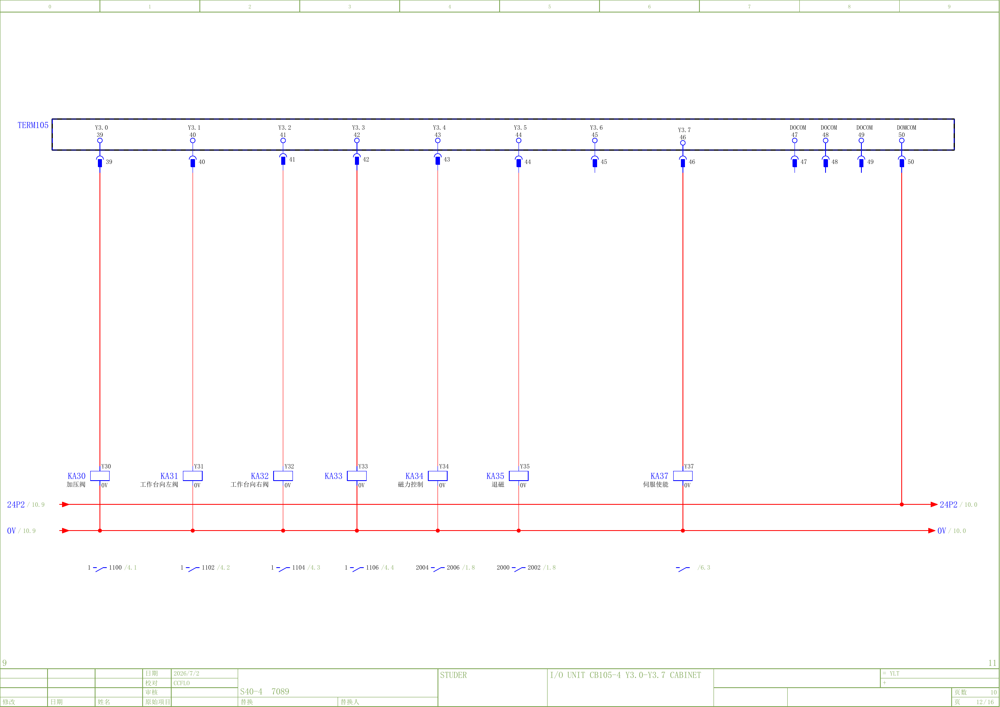

# FAVRETTO MC160：CB105 X3/X8/X9 输入与 Y2/Y3 输出端子图

> 资料一致性警告：PDF 封面写有“FAVRETTO MC160 / FANUC 0iTF”，但图框页脚同时出现“STUDER / S40-4 / 7089”。因此本案例只能作为待核对图纸，不能在未比对现场线号和元件铭牌前直接施工。

## 1. 功能

汇总 TERM105/CB105 柜内输入 X3.0-X3.7、X8.0-X9.7 和输出 Y2.0-Y3.7。

## 2. 具体电路图

### 原图第 9 页



### 原图第 10 页



### 原图第 11 页



### 原图第 12 页



- [打开完整 16 页原始 PDF](../assets/favretto_mc160/FAVRETTO_MC160_电路图_原始文件.pdf)

## 3. 文字化电路图

```text
按钮/限位/E-STOP → TERM105 → X3/X8/X9；PMC Y2/Y3 → TERM105 → KA20-KA37 → 电机接触器、阀、磁力/退磁和伺服使能。
```

按钮/限位/E-STOP → TERM105 → X3/X8/X9；PMC Y2/Y3 → TERM105 → KA20-KA37 → 电机接触器、阀、磁力/退磁和伺服使能。

## 4. 故障诊断与核对点

- 建立端子号-地址-现场器件三列校线表。
- 图中“功能不详”和空闲点不得自行定义，需现场追线。
- E-STOP 和伺服使能应确认是否另有硬件安全回路。

## 5. 修改或改造边界

- 元件编号和定值先与现场器件、线号、端子号逐项核对。
- 驱动器、制动电阻、编码器、抱闸和安全输入必须使用对应型号厂家手册。
- 不得仅依据本图确定线径、短路保护、接触器等级或 RC/电阻电容最终参数。
- 上电前执行断电验电、绝缘/接地检查、点对点校线和安全功能测试。

## 6. 来源与验证状态

- 本地来源：`参考资料/FAVRETTOMC160电路图NEW VER.pdf`
- 原图页：9, 10, 11, 12
- 验证状态：图纸封面标识 FAVRETTO MC160；页脚项目字段出现 STUDER/S40-4 7089，归属与器件定值待现场核对
- 整理日期：2026-08-18
