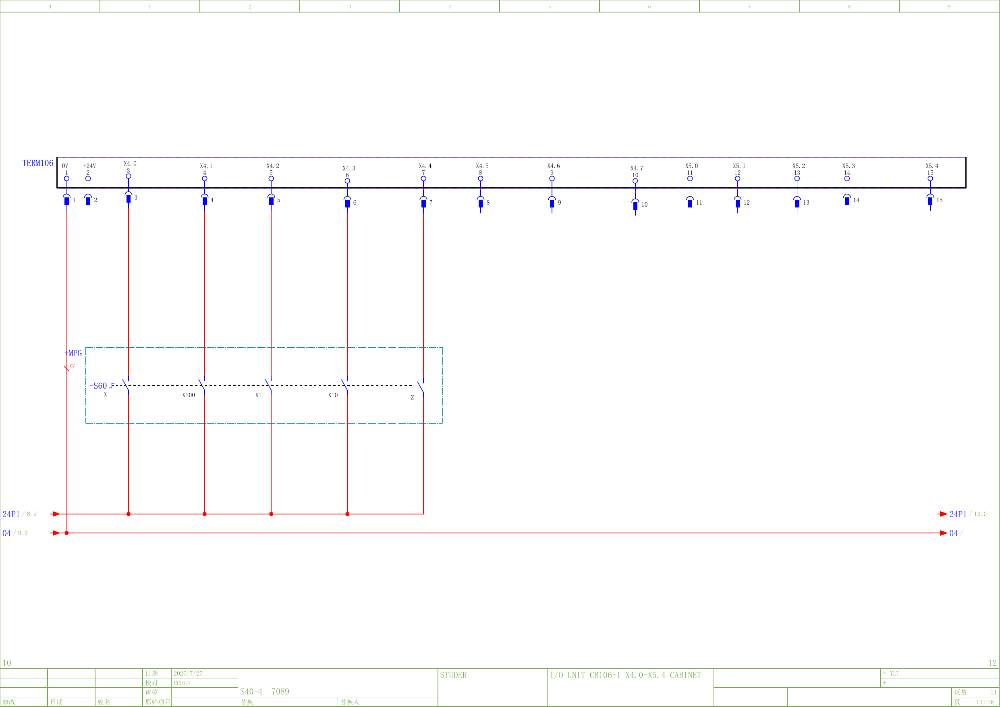
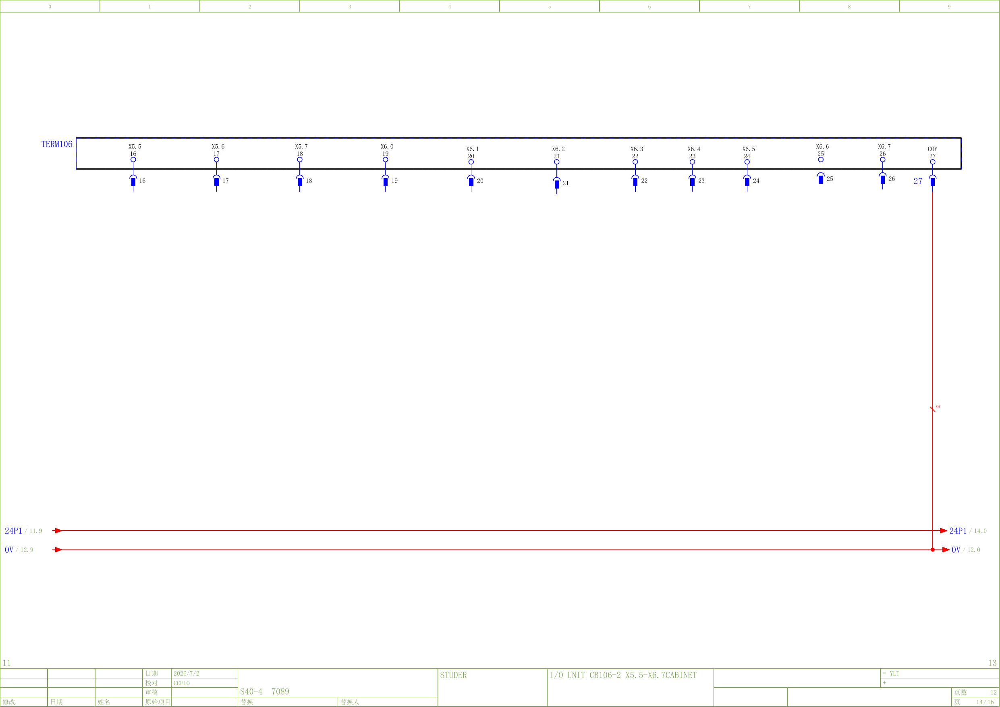
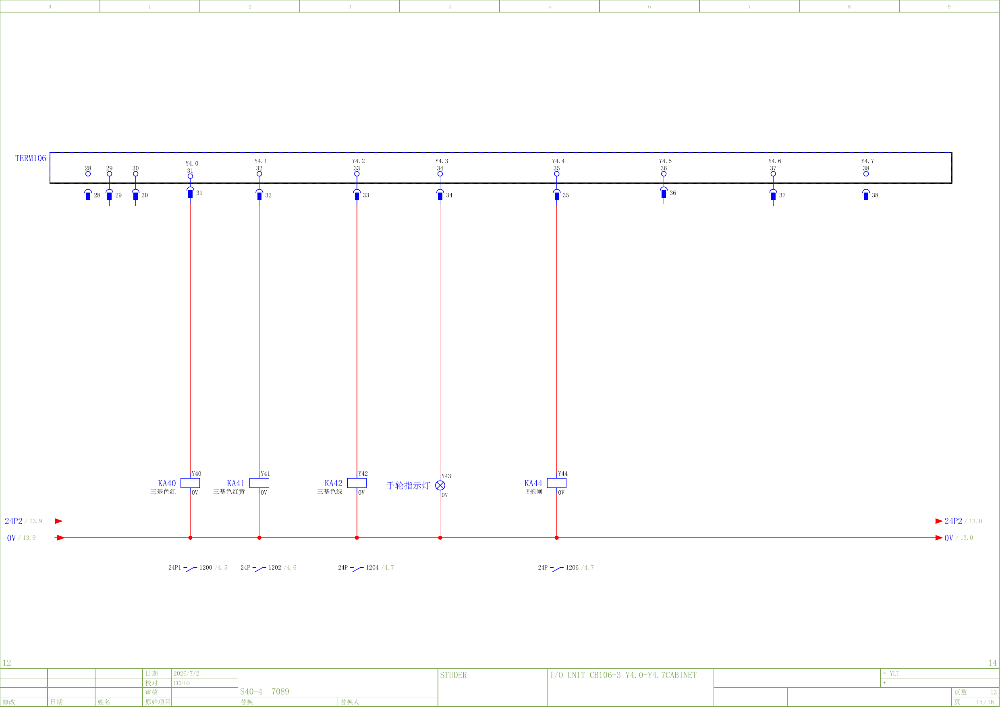
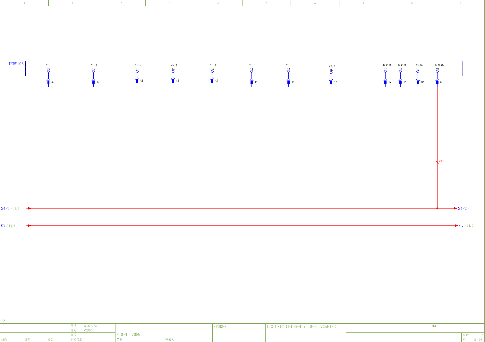

# FAVRETTO MC160：CB106 X4-X6 输入与 Y4-Y5 输出端子图

> 资料一致性警告：PDF 封面写有“FAVRETTO MC160 / FANUC 0iTF”，但图框页脚同时出现“STUDER / S40-4 / 7089”。因此本案例只能作为待核对图纸，不能在未比对现场线号和元件铭牌前直接施工。

## 1. 功能

汇总 TERM106/CB106 的手轮/轴选择输入和三色灯、手轮指示、Y 轴抱闸等输出。

## 2. 具体电路图

### 原图第 13 页



### 原图第 14 页



### 原图第 15 页



### 原图第 16 页



- [打开完整 16 页原始 PDF](../assets/favretto_mc160/FAVRETTO_MC160_电路图_原始文件.pdf)

## 3. 文字化电路图

```text
手轮与轴选择开关 → TERM106 → X4.0-X6.7；PMC Y4.0-Y5.7 → KA40-KA44/指示灯/抱闸 → 现场执行器。
```

手轮与轴选择开关 → TERM106 → X4.0-X6.7；PMC Y4.0-Y5.7 → KA40-KA44/指示灯/抱闸 → 现场执行器。

## 4. 故障诊断与核对点

- 核对 +MPG、0 V、选轴触点和输入公共端接法。
- 空白输出点保持未定义，避免软件与现场接线冲突。
- 抱闸输出必须与伺服驱动器状态和安全回路联合测试。

## 5. 修改或改造边界

- 元件编号和定值先与现场器件、线号、端子号逐项核对。
- 驱动器、制动电阻、编码器、抱闸和安全输入必须使用对应型号厂家手册。
- 不得仅依据本图确定线径、短路保护、接触器等级或 RC/电阻电容最终参数。
- 上电前执行断电验电、绝缘/接地检查、点对点校线和安全功能测试。

## 6. 来源与验证状态

- 本地来源：`参考资料/FAVRETTOMC160电路图NEW VER.pdf`
- 原图页：13, 14, 15, 16
- 验证状态：图纸封面标识 FAVRETTO MC160；页脚项目字段出现 STUDER/S40-4 7089，归属与器件定值待现场核对
- 整理日期：2026-08-18
